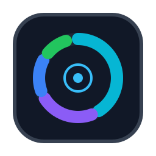
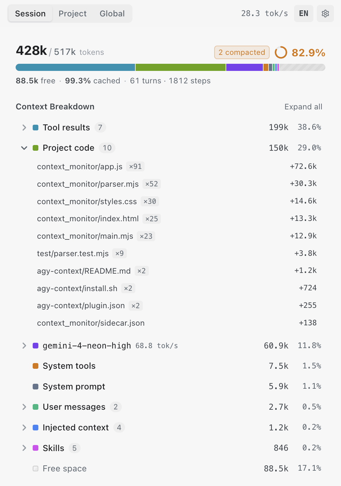
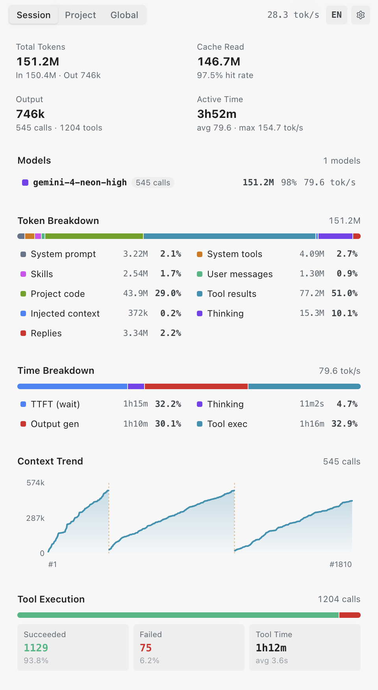
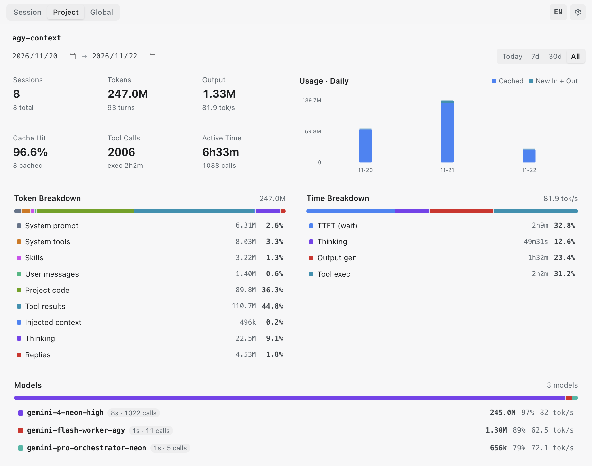
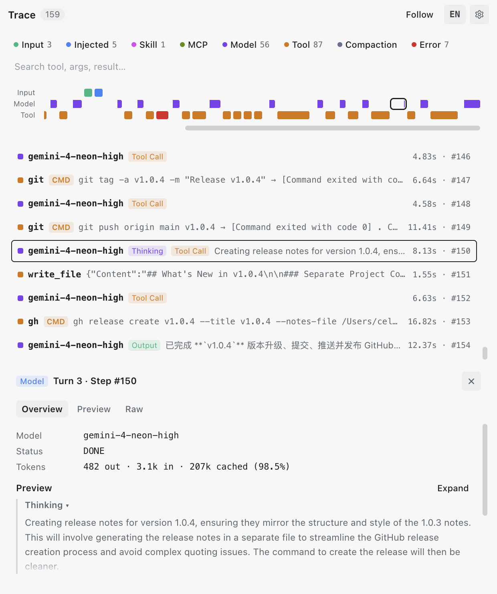
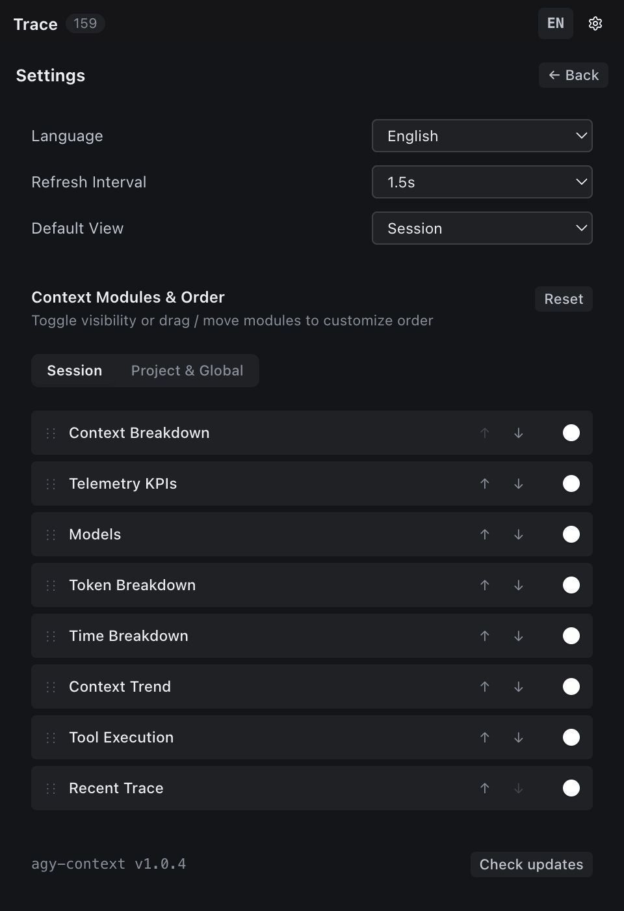

<div align="center">
  
  <h1>AGY Context</h1>
  <p>
    <strong>Real-time session context monitor, full interaction trace inspector, and project/global token analytics docked in Antigravity's right auxiliary pane.</strong>
  </p>
  <p>
    <a href="https://github.com/keleus/agy-context/releases/latest">
      
    </a>
    <a href="https://github.com/keleus/agy-context/actions/workflows/ci.yml">
      
    </a>
    <a href="./LICENSE">
      
    </a>
    
  </p>
  <p>
    <a href="#features--screenshots">Features</a> ·
    <a href="#installation">Installation</a> ·
    <a href="#usage">Usage</a> ·
    <a href="#privacy--architecture">Architecture</a>
  </p>
</div>

---

## Features & Screenshots

### 1. Session Context Window & Telemetry (`Session`)

Monitor real-time context occupancy, per-file code reads, tool/MCP overhead, and full-session performance without slowing down Antigravity.

| Context Window & Breakdown | Telemetry, Breakdowns & Context Trend |
| :---: | :---: |
|  |  |

- **Adaptive Context Occupancy & Ring Gauge**: Reads each model's true context ceiling directly from Antigravity's DB, displays circular occupancy warnings (`≥80%` amber, `≥90%` red), full-window horizontal composition bar with free space, cache hit rate, compaction counter, and real-time latest-call speed in the top bar.
- **Current-Window Context Breakdown**: Mutually exclusive breakdown across `Project code` (project `read_file` / `view_file` reads merged per file with `×N` counts), `Tool results` (grouped by MCP server/tool, shell commands, and built-in tools), `Skills`, `System prompt`, `System tools`, `User messages`, `Injected context`, and per-model output (`Thinking` & `Text output`).
- **Real Measured Telemetry**: 4-metric KPI strip (`Total Tokens`, `Cache Read`, `Output`, `Active Time` with `avg` & `max` `tok/s`), **Models**, cumulative **Token Breakdown**, **Time Breakdown** (real nanosecond TTFT, Thinking, Output gen, and active Tool execution excluding approval waits), **Context Trend** (smooth Bezier curve segmented at every compaction drop), **Tool Execution**, and **Recent Trace**.

---

### 2. Project & Global Insights (`Project | Global`)

<p align="center">
  
</p>

- **Flexible Time Ranges & Adaptive Charts**: Pick any custom `Start → End` date range or use quick presets (`Today`, `7d`, `30d`, `All`) with adaptive `hour` / `day` / `week` / `month` / `year` usage bars (`Cached` vs. `New In + Out`).
- **Multi-Dimensional Breakdowns & Rankings**: Inspect workspace-scoped or cross-workspace **Token & Time Breakdown**, **Models**, **Tool Execution**, ranked **Skills / Tools / Commands** (with `MCP` & `CMD` badges, sortable by `Count`, `Time`, or `Context`), and searchable session cards with one-click jump.

---

### 3. Live Interaction Trace (`Trace` Side Pane)

<p align="center">
  
</p>

- **3-Track Duration-Proportional Timeline Strip**: Fixed left lanes (`Input` / `Model` / `Tool`) where model & tool pills scale by real duration (`5s = 10px`), two-tone model pills separate Thinking from Output/Tool Call, dashed vertical dividers mark **Context Compaction**, and independent horizontal lazy loading keeps long sessions smooth.
- **Exclusive Filters, Revert Detection & Detail Drawer**: Filter independently by `Input`, `Injected`, `Skill`, `MCP`, `Model`, `Tool`, `Compaction`, and `Error`, search across args/results, automatically flag superseded **Reverted** branches, and inspect formatted Markdown previews, tool payloads, host errors, and raw JSON inline.

---

### 4. Customization, Theme Sync & One-Click Self-Update

<p align="center">
  
</p>

- **Bilingual UI & Native Theme Sync**: Instant English / Simplified Chinese (`EN / 简`) toggle and automatic synchronization with Antigravity's Light & Dark themes.
- **Context Modules & Order Editor**: Show/hide and drag-or-move cards independently for **Session** and **Project & Global**, with responsive 2-column layout on wide panes and atomic persistence in `$PLUGIN_DATA/settings.json`.
- **In-Place Self-Update**: Checks GitHub Releases directly from the side pane and upgrades + reloads cleanly with zero stale files.

---

## Installation

### Option 1: One-Line CLI Install (Latest GitHub Release — Recommended)

Install or upgrade directly to the latest CI-packaged release (with automatic SHA-256 verification):

```bash
curl -fsSL https://github.com/keleus/agy-context/releases/latest/download/install.sh | bash
```

Install a specific version:

```bash
curl -fsSL https://github.com/keleus/agy-context/releases/latest/download/install.sh | bash -s -- --version v1.0.4
```

Uninstall via CLI:

```bash
curl -fsSL https://github.com/keleus/agy-context/releases/latest/download/install.sh | bash -s -- --uninstall
```

### Option 2: Antigravity CLI

```bash
agy plugin install https://github.com/keleus/agy-context
```

### Option 3: From Local Repository (Development)

```bash
git clone https://github.com/keleus/agy-context.git
cd agy-context
./install.sh --link   # symlink into ~/.gemini/config/plugins/agy-context
# or
./install.sh --copy   # copy runtime files into ~/.gemini/config/plugins/agy-context
```

To uninstall locally:

```bash
./install.sh --uninstall
```

---

## Usage

1. Confirm **AGY Context** is enabled under **Skills & Customizations → Plugins** in Antigravity (after an in-place CLI upgrade, toggle it off and on once to restart the background sidecar).
2. Open **Context** (`Session | Project | Global`) and/or **Trace** (live interaction history) from the conversation header's `+` menu or **Overview → Extensions**.
3. Both views share one lightweight read-only sidecar and automatically track the active conversation.

---

## Privacy & Architecture

| Aspect | Implementation |
| :--- | :--- |
| **Telemetry Source** | Read-only access to local transcripts (`~/.gemini/antigravity/brain/<id>/.system_generated/logs/`) and per-conversation SQLite DBs (`~/.gemini/antigravity/conversations/<id>.db`). |
| **Zero Hooks** | Never modifies conversation files, runs lifecycle hooks, or intercepts tool approvals. |
| **Runtime** | Zero external dependencies — runs directly on Antigravity's bundled Node.js runtime (`sidecar_sdk` + built-in `node:sqlite`). |
| **Settings Storage** | Stored atomically in `$PLUGIN_DATA/settings.json`. |
| **Release Packaging** | Automated via GitHub Actions CI (`ci.yml` + `release.yml`), publishing clean runtime archives (`agy-context.tar.gz`, `agy-context-<tag>.zip`, `install.sh`, `SHA256SUMS.txt`). |

---

## License

Licensed under the [Apache License 2.0](./LICENSE).
